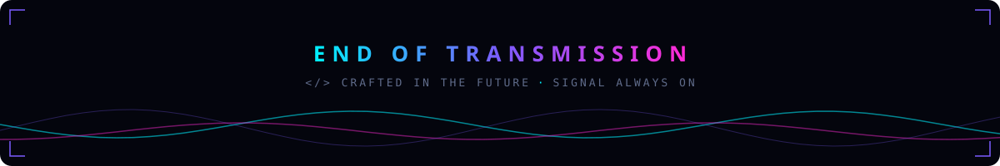

 

  

 

 

 

<picture>
  <source media="(prefers-color-scheme: dark)" srcset="https://raw.githubusercontent.com/yatharthdahiyaa/yatharthdahiyaa/output/snake-dark.svg">
  <source media="(prefers-color-scheme: light)" srcset="https://raw.githubusercontent.com/yatharthdahiyaa/yatharthdahiyaa/output/snake-light.svg">
  
</picture>

 

 

<!-- Add your own channels, e.g.:

-->

  

